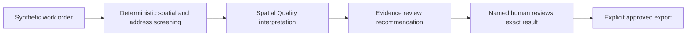

# Workflow runbooks

## 1. Synthetic address-quality screening

**Goal:** produce a defensible screening report and a queue of human follow-up, without editing source data.



The interpretation and evidence-review stages above are manual activities supplied by this playbook. They are not additional nodes currently wired into the engine. Approval of an engine result does not automatically cover a separately edited interpretation report.

Run the existing example from the repository root:

```bash
PYTHONDONTWRITEBYTECODE=1 python3 -m unittest discover -s geoagent_os/tests -v
PYTHONDONTWRITEBYTECODE=1 python3 -m geoagent_os.demo --output /workspace/geoagent-runtime
python3 -m geoagent_os --db /workspace/geoagent-runtime/demo.sqlite list
```

Keep the runtime directory outside the static website root. The demo creates three synthetic workflow examples and does not approve them. Repeating it does not duplicate unchanged examples. Do not run it against a client database.

For the supplied spatial example, the interpretation must preserve these observations:

| Observation | Evidence | Correct interpretation |
| --- | --- | --- |
| Three features | `geoagent_os/examples/spatial-qa.json`, `$.data.geojson.features` | Screening scope is three supplied Point features. |
| Shared coordinates on rows 0 and 1 | Spatial screening code `SHARED_COORDINATES` | Separate units 1 and 2 share a location; review finding, not proof of duplication. |
| Row 2 outside coordinate range | Coordinates `[-181, 91]`; `OUT_OF_RANGE` | Flag for GIS lead investigation; do not guess corrected coordinates. |
| Row 2 missing address | Empty address text; `MISSING_ADDRESS` | Request authoritative address evidence; do not invent a street address. |
| Three finding events | Two spatial issues plus one address issue | Two unique features have findings: rows 1 and 2. Finding count is not affected-feature count. |

The Python report's `findings` value counts issue entries. A draft must not rename it “invalid features.” No topology or positional-accuracy certification follows from this example.

**Handoff:** input reference, deterministic result, proposed follow-up queue, scope/limitations, owner, and checks. Use the existing hash-bound review/export commands only after an actual human reviews the engine result. Do not synthesize a reviewer decision as part of a demo.

## 2. Opportunity qualification and proposal outline

**Goal:** distinguish a worthwhile, evidenced opportunity from an attractive but unsupported draft.

1. Intake the source solicitation, amendments, deadlines/timezones, required submission format, eligibility, evaluation criteria, and permitted evidence inventory.
2. Have the Opportunity and Proposal Specialist produce a requirement matrix. Each mandatory requirement needs a source, owner, response plan, evidence status, and unresolved question if applicable.
3. Have the Evidence Reviewer check every factual company claim against the approved inventory and every compliance statement against the solicitation.
4. Return a pursue/hold/decline recommendation for the Business Development Lead. Keep unverified qualification and pricing fields explicit.
5. Prepare a draft outline only within those bounds. Submission and client communication are separate human-controlled actions with no execution adapter in this release.

**Synthetic acceptance example:** `geoagent_os/examples/opportunity.json` supplies a title and three requirement themes, but no `source_url`. Its deadline text explicitly says human input is required. The correct result is a useful draft outline with qualification blocked pending source documents and deadline verification. A citation to the local JSON does not make it a live opportunity.

**Stop conditions:** conflicting amendments, unresolved mandatory eligibility, missing authoritative deadline, or unsupported claims needed to make a response appear compliant. Produce the partial matrix and precise clarification request; do not send a clarification externally.

## 3. Engagement onboarding and project reporting

**Goal:** give the owner a concrete plan without claiming that access, agreements, or delivery have occurred.

1. Operations drafts an engagement checklist and names scope, data, acceptance, access, and contractual gaps.
2. Project reporting summarizes only observed workflow results and recorded decisions. Label templates and proposed dates honestly.
3. Evidence review compares completion claims to artifacts/events and distinguishes prepared, approved, exported, delivered, and accepted.
4. The owner supplies missing agreements and permissions through approved channels. A drafted checklist is not a signed agreement or an access grant.

**Handoff:** owner/action/dependency register, evidence references, review state, next checkpoint, and blockers. Keep invoices, financial writes, account provisioning, and notifications outside the automated pilot.

## 4. Website and command-center review

**Goal:** identify concrete barriers and misleading capability claims without changing the established site architecture.

Review discovery → services/project evidence → contact; then the command center's public capabilities and activity availability states. Use the Accessible GIS Experience Reviewer for usability barriers and the Evidence Reviewer for factual claims. Look for discrepancies between advertised tools and implemented adapters.

Require browser evidence for interactions and responsive behavior. Source inspection alone cannot demonstrate keyboard focus, form submission success, or screen-reader operation. Existing Node checks cover assets, endpoint alignment, mocked forms and orchestration; they are not a browser accessibility audit.

Deliver a prioritized issue register with precise reproduction, expected behavior, evidence, and a scoped change proposal. Public publishing and cloud configuration changes are outside these runbooks.
